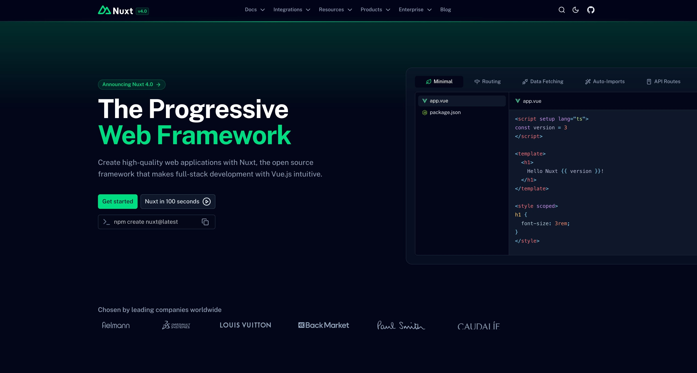

<a href="https://nuxt.com"></a>

[](https://nuxt.com/mcp/deeplink)
[](https://nuxt.com/mcp/deeplink?ide=vscode)

# nuxt.com

Welcome to the Nuxt website repository available on [nuxt.com](https://nuxt.com).

[](https://ui.nuxt.com)
[](https://nuxt.care)

## Quickstart

No environment variables are required — the site runs out of the box:

```bash
corepack enable
pnpm install
pnpm dev
```

In this default mode (`--ui-only`):

- The docs are cloned from the public [nuxt/nuxt](https://github.com/nuxt/nuxt) and [nuxt/examples](https://github.com/nuxt/examples) repositories.
- Ecosystem APIs (`/api/v1/**` — modules, templates, etc.) are proxied to nuxt.com.
- The Nuxi agent is visible but disabled: the Eve runtime is not spawned, so no AI keys are needed.

## Development modes

| Command | What it does |
|---------|--------------|
| `pnpm dev` | UI-only mode — zero config, no Eve agent, ecosystem APIs proxied to nuxt.com |
| `pnpm dev:nuxi` | UI-only mode + the Nuxi agent — spawns the Eve runtime (needs `AI_GATEWAY_API_KEY` and `INTERNAL_API_SECRET`) |
| `pnpm nuxi` | Eve TUI only — `layers/nuxi`'s `dev` script (`eve dev`) |
| `pnpm dev:full` | Full mode — spawns the Eve agent runtime and fetches the Nuxt ecosystem locally |

`pnpm dev:full` requires some environment variables (see [`.env.example`](./.env.example), notably `AI_GATEWAY_API_KEY` for the agent). All variables in `.env.example` are optional and grouped by feature — only set what you need.

### Working on the docs

The docs live in the [nuxt/nuxt](https://github.com/nuxt/nuxt) repository. To edit them locally, clone/fork the repo somewhere outside this project and point the `NUXT_V2_PATH` / `NUXT_V3_PATH` / `NUXT_V4_PATH` / `NUXT_V5_PATH` variables in your `.env` to your local checkout (use `pwd` — or `echo %cd%` on Windows — inside the clone to get the path). Same goes for `NUXT_EXAMPLES_PATH` with [nuxt/examples](https://github.com/nuxt/examples).

### Previewing a pull request

`/pull/:repo/:number` mirrors `github.com/nuxt/:repo/pull/:number`: it renders the site's content pages with that pull request's content (any other page redirects to production), and lands on the first page it changes. `:repo` is `nuxt`, `cli`, `examples` or `nuxt.com`, and the pull request's base branch picks which content it replaces (`nuxt/nuxt`'s `main` is the 5.x docs). Only open pull requests with the `preview:enabled` label can be previewed, and a push removes it: a maintainer adds it back once they have reviewed the new commits.

### Signing in locally

Sign-in (dashboard, chat history) needs a GitHub OAuth app: create one at [github.com/settings/applications/new](https://github.com/settings/applications/new) with `http://localhost:3000/api/auth/callback/github` as the callback URL, then set `NUXT_OAUTH_GITHUB_CLIENT_ID` and `NUXT_OAUTH_GITHUB_CLIENT_SECRET` in your `.env`.

### Add a Nuxt Template

To list a Nuxt template, add a file in the [./content/templates](./content/templates) directory.

Make sure to start the development server in order to generate the screenshot for the template and go to http://localhost:3000/templates to see the result.

If you want to update the url where we take the automated screenshot, use the `screenshotUrl` property.

To regenerate the image, delete the generated one in `public/assets/templates`.

## Production

Build the application for production:

```bash
pnpm build
```

### MCP Toolkit preview

The toolkit dependency is pinned to [the 1.0 preview from `947973a`](https://github.com/nuxt-modules/mcp-toolkit/pull/423), the tip of the beta stack. Its matching Nitro runtime preview is pinned by the package itself. This branch tests that preview before switching to a published beta.

```bash
pnpm install --frozen-lockfile
pnpm dev
```

The public server card at `/.well-known/mcp/server-card.json` contains only the public catalog. Admin tools and prompts live separately in `server/mcp-admin` and are discovered by the `admin` server configured in `nuxt.config.ts`. Each server keeps its metadata and instructions in its own `index.ts`. The admin index also defines authentication.

### Admin MCP OAuth

People connect to `/mcp/admin` with their GitHub login: nuxt.com is the OAuth 2.1 authorization server for that endpoint (`server/utils/mcp-oauth.ts`), and the toolkit verifies its tokens as the resource server. An MCP client discovers the server from the `401` challenge, registers itself (`/oauth/register`), and sends the person to `/oauth/authorize`. That page reuses `/login`, accepts only admins, and asks for consent. Clients then exchange the code with PKCE at `/oauth/token` and get a one-hour access token for `/mcp/admin` and a rotating 30-day refresh token. Each refresh re-checks admin access, and replaying a used code or refresh token revokes the whole sign-in.

Tools and prompts declare `scopes`: `admin:chats` for chat transcripts and votes, `admin:templates` for template checks, `admin:analytics` for everything else. Grants live in the `admin_mcp_oauth_grants` table; signing keys derive from `NUXT_APP_SECRET`, which must be set. MCP clients either register dynamically or use an HTTPS client ID metadata document (CIMD), which may authenticate with `private_key_jwt`. The Nuxi agent signs in the same way through Vercel Connect, always against `https://nuxt.com/mcp/admin` (also from local dev, with a Vercel OIDC token from `vercel env pull`): the `nuxt.com/nuxi` connector is created on first use, and an admin installs it once from the Connect dashboard and approves it on nuxt.com's consent page; the grant then follows that admin's access. Locally, run `pnpm dev` and connect a client to `http://localhost:3000/mcp/admin`; set `NUXT_ADMIN_GITHUB_LOGINS` to your login.

Public tools and resources use native Nitro cached functions with their existing 10-minute, 30-minute or 1-hour lifetimes. Cache keys include the request origin and parsed arguments. No MCP client credentials are needed for the public endpoint.

### Running Evals for the MCP Server

To run the evals for the MCP server, follow these steps:

1. **Ensure your development server is running**  
   Start the local Nuxt development server:
   ```bash
   pnpm dev
   ```

2. **Create an AI Gateway API key**  
   Go to https://vercel.com/ai-gateway and create an API key.
   Add the following variable to your `.env` file (replace `sk-...` with your actual key):
   ```
   AI_GATEWAY_API_KEY=<your-api-key>
   ```

3. **Run the evals**  
   You can execute the evals from the command line:
   ```bash
   pnpm eval
   ```

   Or launch the interactive UI to run them via a web interface:
   ```bash
   pnpm eval:ui
   ```

## Nuxi (Eve agent)

Nuxi lives in [`layers/nuxi/`](./layers/nuxi/) — Eve runtime (`agent/`), UI, and internal APIs in one layer. The agent only runs with `pnpm dev:full` (in the default `pnpm dev` ui-only mode, the Eve runtime is not spawned and the chat UI shows a disabled state). For local development:

```bash
# Required — Vercel AI Gateway key for the agent model
AI_GATEWAY_API_KEY=<your-api-key>

# Required — shared secret between the Nuxt app and Eve runtime
INTERNAL_API_SECRET=$(openssl rand -base64 32)

# Optional — canonical site URL for MCP + internal API callbacks
NUXT_PUBLIC_SITE_URL=http://localhost:3000

pnpm dev:nuxi
```

Eve TUI only (no Nuxt UI): `pnpm nuxi`. Symlink the root `.env` / `.env.local` into `layers/nuxi` so Eve picks them up. Set `NUXI_CLI_ADMIN=1` for admin tools (ignored when `VERCEL_ENV=production`). For **web chat** admin without being on the Nuxt core team, set `NUXT_ADMIN_GITHUB_LOGINS=your-github-login` and sign in with GitHub (also ignored in production — use Global Config `admin.githubLogins` there). Point at a running site with `pnpm nuxi -- http://localhost:3000`.

On Vercel, configure **both** the `web` and `eve` services (`vercel.json`) with the same `INTERNAL_API_SECRET`, `AI_GATEWAY_API_KEY`, and database env vars.

## License

[MIT License](./LICENSE)
